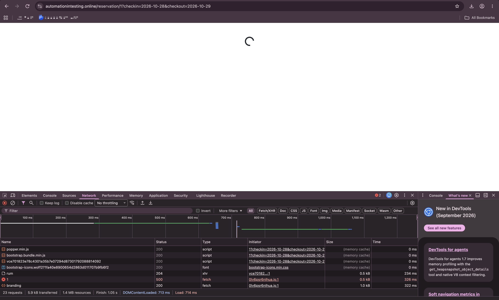

# QA Lead Take-Home

---

### How to run

Requires Node 20.12+ (for `process.loadEnvFile`). Tested on Node 24, pinned in `.nvmrc`.

```bash
nvm use               # picks up .nvmrc
cp .env.example .env  # BASE_URL, ADMIN_USER, ADMIN_PASSWORD
npm install
npx playwright install chromium
npm test              # everything
npm run test:api      # API tests only
npm run test:ui       # browser test only
npm run report        # open the HTML report
npm run test:ui:mode  # open Playwright UI mode to run, watch and debug tests
npm run clean         # delete test-results/, playwright-report/ and blob-report/
```

Each `test` script runs `clean` first, so the report and traces only ever show the latest run.


Configuration lives in `.env` (git-ignored; `.env.example` is the template). By default it points at the hosted instance. To run against a local instance, set `BASE_URL=http://localhost` in `.env`, or override it for one run (shell variables win over `.env`):

```bash
BASE_URL=http://localhost npm test
```

**Running the platform locally** (this is how I checked the browser test while the hosted site was broken):

1. Clone the [platform repo](https://github.com/mwinteringham/restful-booker-platform). I used commit `efe2deb`.
2. Build the Java services. They need JDK 26 and Maven, which a container can provide:
   `docker run --rm -v "$PWD":/src -v rbp-m2:/root/.m2 -w /src maven:3-eclipse-temurin-26 mvn -q -B package -DskipTests -Drevision=$(git rev-parse --short HEAD) -pl auth,booking,branding,message,report,room -am`
3. In `assets/Dockerfile`, copy the six `*_API` `ENV` lines from the `runner` stage into the `builder` stage, before `RUN npm run build`. Without this, every `/api/<resource>/{id}` route returns 500 (see bug report).
4. `docker compose up -d --build`, then open http://localhost.

### What's covered and why

| Test | Level | Why it matters |
|---|---|---|
| A guest can book a room once, and overlapping stays are rejected | API | Taking bookings is the business, and double-booking is the most expensive failure a B&B can have. The test also checks that the booking reaches the admin view the owner works from. |
| Availability search hides a room for any stay that overlaps a booking | API | The search is how guests decide what to book. It currently fails (see Other issues), so it's marked `test.fail()`: CI stays green while the bug is open, and the test turns red once the fix lands, so the marker gets removed. |
| A guest can book a room from the website and the owner sees the booking | Browser | The main revenue journey, end to end. It finishes with an API check, because a "Booking Confirmed" screen alone doesn't prove anything was saved. |

I left out admin CRUD screens, the contact form, branding, and visual checks. They matter less than "can a guest book, and is the owner protected from double-bookings."

### Coping with the shared, resetting instance

- **Each test creates its own room** through the admin API, with a unique name, so other people's bookings can't collide with ours and seed data doesn't matter. `POST /api/room` doesn't return an id, so the helper looks the room up by name.
- **Dates are far in the future** (400+ days), clear of seed bookings and of anyone testing "tomorrow."
- **Setup is done through the API, not the UI**, so tests run in seconds and only the browser test drives the browser.
- **`retries: 1`** covers the case where the 10-minute reset wipes data mid-test. Each test rebuilds its own data, so a retry starts clean. Traces are recorded on retry for diagnosis.
- **No cleanup step**: `DELETE /api/room/{id}` and `DELETE /api/booking/{id}` return 500 on the hosted site (see below), so test data is left for the reset to clear. Against a local instance I'd add an `afterEach` delete.

### Current results

| Test | Hosted site | Local (with the build fix) |
|---|---|---|
| Booking and double-booking (API) | ✅ pass | ✅ pass |
| Availability overlap (API, known bug) | ✅ fails as expected | ✅ fails as expected, same 3 cases |
| Guest booking (browser) | ✅ fails as expected: `GET /api/room/{id}` returns 500 | ✅ pass |

Against the local stack the whole suite passed 15 of 15 runs (`--repeat-each=5`). The browser test fails on the hosted site because of the bug reported below, so it's marked `test.fail()` only when `BASE_URL` points at the hosted site. The suite stays green there, and the test turns red once the hosted site is fixed. It checks the room-details response first, so the failure message names the cause instead of timing out on a spinner.

### What I'd do next with more time

1. **Run against a local docker-compose instance in CI** (GitHub Actions: build the platform at a pinned commit, start the stack, wait for health, `BASE_URL=http://localhost npm test`, upload the HTML report and traces). Keep a smaller smoke run against the hosted site on a schedule. A smoke test that just opens a reservation page would have caught the bug below on day one.
2. **Browser test for a rejected booking**: book dates that are already taken and expect an error message, not a crashed page (see Other issues).
3. **Booking validation tests** at the API level, driven by a table of inputs (name and phone length, email format, checkout before checkin, past dates). Cheap to run and catches regressions.
4. **Admin auth checks:** every admin endpoint returns 401 without a token or with an expired one.
5. **Accessibility scan** (axe) on the home and reservation pages.

### Using AI

- I used Cursor as a pair. It explored the API, read the platform source to find stable selectors, scaffolded the Playwright project, and drafted the README for me to edit. 
- I used the Playwright MCP and Opus 5.5's probing abilities to find bugs (I vetted them myself).
- I did not like the suggestions it gave for for part 1 of this assessment so I did those myself, but used AI to make it presentable and my sentence construction lol
- I told AI what I wanted to be automated but had it create the test plan and do the coding, but I reviewed everything.
- I did set up the framework conventions and configs myself
- I ran into the bug myself while I was navigating through the app, but had AI make up the bug report below and even add in the root cause [I assume that's acceptable :v ]

---

## Bug report

**Title:** Guests can't book any room. Every `/api/<resource>/{id}` route returns 500 because the front end's proxy rules are baked in with `localhost` URLs at build time.

**Severity:** Blocker. The reservation page never loads, for every room, so no guest can make a booking through the website. The single-resource API routes are broken too: `GET /api/booking/{id}`, `DELETE /api/booking/{id}`, `DELETE /api/room/{id}` and `GET /api/report/room/{id}` all return 500. I didn't check the admin screens that use them.

**Environment:** https://automationintesting.online (seen 2026-10-28, still failing after 14+ minutes and across a data reset). Also reproduced on a clean local `docker compose up` of `trunk` at commit `efe2deb`, so it's in the code, not just the hosted environment.

**Steps to reproduce**
1. Open https://automationintesting.online and click **Book now** on any room. The reservation page shows a spinner forever.
2. Or call the API directly:
   - `curl -s -w '\nHTTP %{http_code}\n' https://automationintesting.online/api/room/1` returns `Internal Server Error` / `HTTP 500`
   - `curl -s -o /dev/null -w 'HTTP %{http_code}\n' https://automationintesting.online/api/room` returns `HTTP 200`

**Expected:** `GET /api/room/1` returns room 1, and the reservation page shows the calendar and the **Reserve Now** button.

**Actual:** Every dynamic `/{id}` route (`/api/room/1`, `/api/booking/1`, `/api/report/room/1`, `DELETE /api/booking/{id}`, …) returns 500. Static routes (`/api/room`, `/api/booking?roomid=`, `POST /api/booking`) work. Locally, the `rbp-assets` log shows `Failed to proxy http://localhost:3001/room/1 Error: connect ECONNREFUSED 127.0.0.1:3001`.

**Evidence:** The hosted reservation page for room 1, stuck on its spinner. In the DevTools Network tab, the room details fetch (`1`, i.e. `GET /api/room/1`) returns `500`, while `branding` and the other requests return 200:



**Root cause:**
- `assets/next.config.js` builds its `rewrites()` from `process.env.ROOM_API` and similar, falling back to `http://localhost:300x`. Next.js resolves rewrites when it builds the app.
- `assets/Dockerfile` sets the `*_API` variables only in the `runner` stage, so they're undefined during `npm run build`, and every rewrite points at `localhost` inside the front-end container.
- Next.js applies these rewrites before dynamic routes like `app/api/room/[id]` but after static ones. So static routes reach their handlers (which read the variables at runtime, correctly), and dynamic routes are proxied to a port where nothing is listening.

**Fix:** Set the `*_API` variables in the `builder` stage too, or pass them as build args. I verified this locally: `/api/room/1` and `/api/report/room/1` return 200, and the browser test passes. Longer term, remove either the rewrites or the duplicate `[id]` route handlers so there's only one proxy path.

**How to catch it next time:** A post-deploy smoke test that opens one reservation page. Our browser test does this and fails with `GET /api/room/{id} must succeed`.

---

### Other issues

#### 1. Availability search shows a room as free for dates that partly overlap an existing booking (High)

Guests are offered rooms they can't book. Combined with issue 2, picking one of these rooms crashes the booking page. There's no data corruption: the server correctly refuses the double-booking. The second API test reproduces this; it's reproduced on both the hosted site and the local copy.
1. Book room 2 for 2032-05-04 → 2032-05-06 (`POST /api/booking`, returns 201).
2. Search availability for each date range below with `GET /api/room?checkin=<in>&checkout=<out>`.

| Search | Overlaps booking? | Room 2 shown as available? |
|---|---|---|
| 05-04 → 05-06 (same dates) | yes | no ✅ |
| 05-01 → 05-10 (wraps booking) | yes | no ✅ |
| 05-03 → 05-05 (starts night before) | yes | **yes ❌** |
| 05-05 → 05-07 (starts mid-stay) | yes | **yes ❌** |
| 05-04 → 05-05 (shorter stay inside) | yes | **yes ❌** |
| 05-06 → 05-08 (starts on checkout day) | no | yes ✅ |

3. Try to book room 2 for 05-05 → 05-07, the range the search just offered.

**Expected:** Any search range that overlaps an existing booking excludes the room.

**Actual:** The room is excluded only when the search range fully covers the booking. For partial overlaps it's listed as available, and the booking attempt returns `409 {"error":"Failed to create booking"}` with no explanation.

**Likely cause:** The availability query seems to check "booking falls inside the search range" when it should check that the two ranges overlap (`booking.checkin < search.checkout AND booking.checkout > search.checkin`).

**Notes:** `test.fail()` in the availability test covers this bug; remove the marker once it's fixed.

#### 2. Booking page crashes when the booking is rejected (High)

Reproduced locally. Book a room's dates through the API, then try the same dates as a guest on its reservation page. `POST /api/booking` returns `409 {"error":"Failed to create booking"}`. `BookingForm.tsx` does `setBookingErrors(errorData.errors)`, but the body has `error`, not `errors`, so the state becomes `undefined`. The page then throws `Cannot read properties of undefined (reading 'length')` and is replaced by "This page couldn't load." The guest gets no explanation and loses everything they typed into the form.

